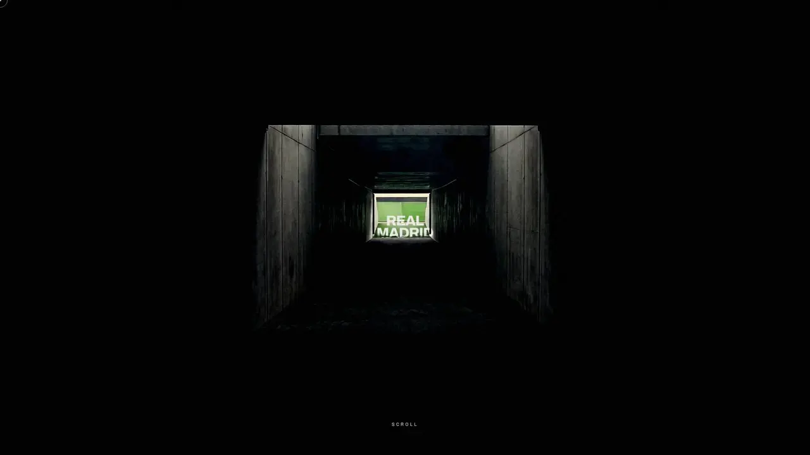

[English](README.md)

# Real Madrid — The Eternal Club

Experiência cinematográfica de página única, guiada pela rolagem, sobre a história do Real Madrid, feita com Vite, React e Three.js. Foi pensada para ser vista em 1920×1080 no desktop e gravada em tela para portfólio e redes sociais.

> **Tipo:** conceito fan-made — não comercial, não oficial, **sem afiliação, endosso ou patrocínio do Real Madrid C.F.** Nomes, escudo e marcas do clube pertencem a seus respectivos donos.



## Funcionalidades

A experiência tem 10 capítulos: 01 Madrid · 02 The Bernabéu · 03 Built by Legends · 04 The Era of Dominance · 05 Kings of Europe · 06 90 Minutes · 07 The Present · 08 Match Centre · 09 Newsroom · 10 Eternal.

- Filme de abertura controlado pela rolagem (sequência de quadros renderizada com Three.js) e efeito de distorção WebGL nos retratos das lendas, com alternativa quando WebGL não está disponível.
- Rolagem suave com Lenis e animações guiadas pela rolagem com GSAP ScrollTrigger.
- **Match Centre:** contagem regressiva para o próximo jogo, filtros por competição, detalhes da partida e tabela interativa da liga.
- **Newsroom:** filtros por categoria, visualização das notícias e links para o site oficial do clube.
- Os dados de temporada e notícias ficam em `src/data/` como um retrato editorial tipado (atualizado em 3 set 2026), de modo que uma API real poderia substituí-lo sem mudar a interface. **Não** são dados ao vivo.
- O capítulo final traz o aviso "unofficial portfolio concept · not affiliated with Real Madrid C.F.".

## Stack

Vite 8 · React 19 · TypeScript 6 · Tailwind CSS 4 · Three.js com React Three Fiber e postprocessing · GSAP · Lenis · Vitest · oxlint. O `sharp` é usado só pelo script de processamento de imagens.

## Como rodar

Requisitos: Node.js 20.19+ ou 22.12+ (Vite 8) e npm.

```bash
npm ci
npm run dev      # abra em 1920×1080 e role a página
```

| Script | O que faz |
|---|---|
| `npm run dev` | Servidor de desenvolvimento |
| `npm run build` | Checagem de tipos (`tsc -b`) e build de produção em `dist/` |
| `npm run preview` | Serve o build de produção localmente |
| `npm run lint` | Lint com oxlint |
| `npm test` | Testes unitários com Vitest |

Nenhuma variável de ambiente é necessária para rodar o app. O `scripts/process-assets.mjs` (pipeline pontual de imagens) lê `RAW_DIR`, a pasta com as imagens originais baixadas.

## Estrutura

```
src/
  sections/      uma pasta por capítulo (Hero, Bernabeu, Legends, Dominance, Kings,
                 NinetyMinutes, Present, MatchCentre, Newsroom, Eternal)
  components/    UI compartilhada (marcadores de capítulo)
  lib/           Lenis, cursor, velocidade de rolagem, utilitários WebGL
  data/          retrato da temporada e das notícias
  archive-v1/    primeira versão do conceito, mantida intacta (com seus testes)
public/assets/   imagens, vídeos e o manifesto de mídias (ASSETS.md)
docs/            especificações de design e notas de direção de arte
scripts/         pipeline de processamento de imagens
```

## Limitações

- Somente desktop, ajustado para 1920×1080; mobile, SEO, página 404, analytics e backend estão fora do escopo.
- Jogos, tabela e notícias são um retrato datado, não um feed ao vivo.
- O bundle de produção tem um chunk maior que 500 kB (aviso do Vite).

## Créditos e origem das mídias

- **Fotografias:** Wikimedia Commons, em domínio público, CC0, CC BY ou CC BY-SA. A lista completa por arquivo (arquivo, autor, licença, link) está em [`public/assets/ASSETS.md`](public/assets/ASSETS.md); os principais créditos estão repetidos abaixo.
- **Vídeos** `public/assets/film/aerial.mp4` e `public/assets/film/facade.mp4`, a sequência de quadros do túnel (`film/tunnel/`) e as demais imagens de `film/`: geradas por IA com Higgsfield (só arquitetura e atmosfera, nunca rostos), segundo o manifesto de mídias do projeto. Os dois clipes do Bernabéu usaram como referência a foto da fachada de MottaW (CC BY 4.0).
- **Escudo do clube** (`public/assets/brand/real-madrid-crest.svg`): marca registrada do Real Madrid C.F., obtido do arquivo hospedado na Wikipedia; **não** tem licença livre. Aparece só no pôster do Match Centre e no capítulo final, em contexto editorial e não comercial, junto do aviso de não afiliação.
- Imagens de uniformes e recortes dos troféus de La Liga / Copa del Rey foram deliberadamente deixados de fora.

<details><summary>Créditos das fotos (Wikimedia Commons)</summary>

- Real Madrid players in 1902-1908 — Unknown author, Public Domain — https://commons.wikimedia.org/wiki/File:Real_Madrid_players_in_1902-1908.jpg
- Di Stéfano, 1959 — Wim van Rossem / Anefo, CC0 — https://commons.wikimedia.org/wiki/File:Di_Stefano_1959.jpg
- Alfredo Di Stéfano, Estadio magazine, 11 Aug 1960 — Unknown author, Public Domain (PD-Chile) — https://commons.wikimedia.org/wiki/File:Alfredo_Di_St%C3%A9fano,_Estadio,_1960-08-11_(898).jpg
- Hugo Sánchez, Real Madrid in Oisterwijk, 1988 — Rob Bogaerts / Anefo, CC0 — https://commons.wikimedia.org/wiki/File:Real_Madrid_in_Oisterwijk_Hugo_Sanchez_,_kop,_Bestanddeelnr_934-2327.jpg
- Ferenc Puskás, Feyenoord v Real Madrid, 1965 — Joost Evers / Anefo, CC0 — https://commons.wikimedia.org/wiki/File:Feyenoord_tegen_Real_Madrid_2-1,_Puskas_in_duel_met_Guus_Haak,_Bestanddeelnr_918-1560.jpg
- Paco Gento, Feyenoord v Real Madrid, 1965 — Rob Bogaerts / Anefo, CC BY 2.0 — https://commons.wikimedia.org/wiki/File:Feyenoord_tegen_Real_Madrid_2-1,_spelmomenten._Gento_(cropped).jpg
- Raúl González, 2008 — Tsutomu Takasu, CC BY 2.0 — https://commons.wikimedia.org/wiki/File:Ra%C3%BAl_Gonz%C3%A1lez_11dic2008.jpg
- Roberto Carlos, 2023 — Flickr via Wikimedia Commons, CC BY 2.0 — https://commons.wikimedia.org/wiki/File:LS3_1288_(53332367864)_(cropped).jpg
- Zinedine Zidane — Walterlan Papetti, CC BY-SA 2.0 — https://commons.wikimedia.org/wiki/File:Zinedine_Zidane.jpg
- Cristiano Ronaldo vs Ludogorets, 2014 — Biser Todorov, CC BY-SA 2.0 — https://commons.wikimedia.org/wiki/File:Ronaldo_vs_Ludogorets_(51101071755)_(Ronaldo_cropped).jpg
- Cristiano Ronaldo after the 2018 Champions League final (Kyiv) — Антон Зайцев (Anton Zaitsev), CC BY-SA 3.0 — https://commons.wikimedia.org/wiki/File:Ronaldo_in_2018.jpg
- Karim Benzema, Real Madrid home kit 2021-2022 — Real Madrid, CC BY 3.0 — https://commons.wikimedia.org/wiki/File:Karim_Benzema_wearing_Real_Madrid_home_kit_2021-2022.jpg
- Vinícius Júnior, Brazil v Morocco, 2026 (x2) — Bryan Berlin / WikiPortraits, CC BY-SA 4.0 — https://commons.wikimedia.org/wiki/File:Vin%C3%ADcius_J%C3%BAnior_Brazil_V_Morocco_13_June_2026-207_(cropped).jpg and https://commons.wikimedia.org/wiki/File:Vinicius_Junior_Brazil_V_Morocco_13_June_2026-94_(cropped).jpg
- Kylian Mbappé, France v Senegal, 2026 — Bryan Berlin / WikiPortraits, CC BY-SA 4.0 — https://commons.wikimedia.org/wiki/File:Kylian_Mbappe_France_v_Senegal_16_June_2026-391_(cropped).jpg
- Jude Bellingham, Laureus World Sports Awards, 2024 — Barcex, CC BY-SA 4.0 — https://commons.wikimedia.org/wiki/File:25th_Laureus_World_Sports_Awards_-_Red_Carpet_-_Jude_Bellingham_-_240422_190558_(cropped).jpg
- Federico Valverde, 2021 — Real Madrid (official YouTube channel still), CC BY 3.0 — https://commons.wikimedia.org/wiki/File:Federico_Valverde_2021_(cropped).jpg
- Bernardo Silva, Croatia v Portugal, 2026 — Bryan Berlin / WikiPortraits, CC BY-SA 4.0 — https://commons.wikimedia.org/wiki/File:Bernardo_Silva_Croatia_v_Portugal_2_July_2026-238.jpg
- Thibaut Courtois, RB Salzburg v Real Madrid, 2019 — Werner100359, CC BY-SA 4.0 — https://commons.wikimedia.org/wiki/File:FC_RB_Salzburg_versus_Real_Madrid_(Testspiel,_7._August_2019)_03.jpg
- Estadio Santiago Bernabéu exterior, December 2024 — MottaW, CC BY 4.0 — https://commons.wikimedia.org/wiki/File:M-estadio-santiago-bernabeu-diciembre-2024-a.jpg
- Museo del Real Madrid, Bernabéu tour — Lệ Xuân, CC BY-SA 4.0 — https://commons.wikimedia.org/wiki/File:170928_Museo_del_Real_Madrid_C._F.jpg
- UEFA Champions League original trophy (1995–2005) — Jay Clark, CC BY-SA 2.5 — https://commons.wikimedia.org/wiki/File:UEFA_Champions_League_original_trophy_(1995-2005).jpg
- Santiago Bernabéu, Real Madrid v Borussia Dortmund, 30 Apr 2013 — Little Savage, CC BY-SA 3.0 — https://commons.wikimedia.org/wiki/File:Santiago_Bernab%C3%A9u_Stadium,_Real_Madrid_-_Borussia_Dortmund,_2013_-_11.jpg
- 2014 Champions League final in Lisbon — Miguelazo84, CC BY-SA 4.0 — https://commons.wikimedia.org/wiki/File:Real_Madird_4-1_Atletico_2014_Final_Champions_Lisboa_3.jpg
- Real Madrid celebrating La Décima, 2014 — El Coleccionista de Instantes Fotografía & Video, CC BY-SA 2.0 — https://commons.wikimedia.org/wiki/File:Final_Champions_League_2014_Real_Madrid_-_Atl%C3%A9tico_de_Madrid_(14081181609).jpg

</details>

## Documentos de design

- Especificação da versão atual: [`docs/superpowers/specs/2026-08-27-eternal-club-design.md`](docs/superpowers/specs/2026-08-27-eternal-club-design.md)
- Especificação da primeira versão: [`docs/superpowers/specs/2026-08-10-real-madrid-legacy-design.md`](docs/superpowers/specs/2026-08-10-real-madrid-legacy-design.md)
- Notas de direção de arte: [`docs/art-direction/`](docs/art-direction/README.md)

## Segurança

Veja [SECURITY.md](SECURITY.md).

## Licença

Ainda não há licença definida; todos os direitos reservados ao autor. Isso vale apenas para o código e o design próprios do projeto. As fotografias de terceiros mantêm suas licenças individuais (veja os créditos acima), e o nome, o escudo e as marcas do clube pertencem ao Real Madrid C.F.
